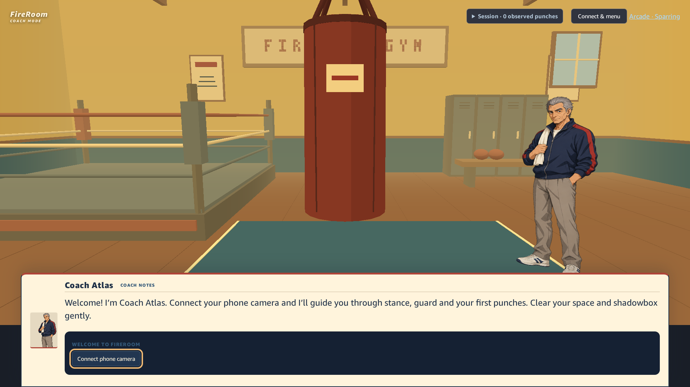
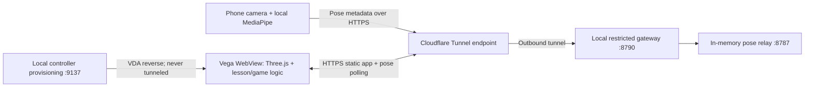

# FireRoom

**Watch the coach. Copy the movement. Learn through play.**

FireRoom is a boxing game prototype for Amazon Fire TV. A smartphone acts as the camera, MediaPipe estimates the player's pose on the phone, and a Vega WebView displays an immersive Three.js boxing gym. Coach Atlas demonstrates guard, jab, cross and jab–cross with cinematic framing and ghost gloves. The game observes practice automatically, gives evidence-based feedback and invites the player to spar with Ren Mori in Arcade Mode.

Current development target: **Amazon Vega Virtual Device**, using a React Native Kepler/WebView wrapper. An earlier Fire OS Android wrapper is preserved separately. Simulator execution is not proof of physical Fire TV compatibility or measured boxing accuracy.



The image above is an actual simulator welcome-screen capture; it contains no participant camera image or pairing QR.

## What you can do

- **Hands-free Coach Mode:** stance self-check → demonstration → automatic practice → feedback → next lesson. No mandatory Practice or Continue presses between successful exercises.
- **Guard hold:** three continuous seconds of observable guard, measured with timestamps. Missing tracking never counts toward the hold.
- **Punch lessons:** stance-aware lead/rear-hand interpretation, movement order and recovery checks. Imperfect technique and uncertain tracking receive different feedback.
- **Visual instruction:** pre-authored ghost-arm guides, camera reframing, Atlas dialogue and playback controls. Guides are teaching animations, not calibrated overlays of the player.
- **Arcade Mode:** a short fight with Ren Mori, virtual health/scoring, opponent attacks and technique reactions. Starting a match requires player confirmation and the existing readiness flow.
- **Phone companion:** QR pairing, camera preview/skeleton, model selection, pose-only transport and reconnection handling.
- **Developer tools:** tracking lab, optional local recordings/exports, geometry comparison, diagnostics and experimental form assessment behind secondary controls.

Atlas currently uses deterministic, grounded offline responses and bounded commands. **A live LLM/Bedrock provider is not configured.** No OpenAI or AWS API key is needed to run this version. Punch scores describe virtual gameplay; they are not measurements of force, real contact, injury risk or precise weight transfer.

## How it works



1. The native Vega wrapper loads the hosted web application. Local runtime provisioning supplies controller authorization without embedding it in the app.
2. Vega creates a session through the restricted gateway and shows a phone QR code.
3. The phone asks for camera permission and runs MediaPipe locally. Its preview is mirrored; landmark left/right labels remain anatomical.
4. Numeric landmarks, tracking confidence, timestamps, sequence numbers and camera context travel through the relay. Normal operation does not upload raw video.
5. The viewer rejects stale/out-of-order data and uses deterministic movement features and rules to identify punches and evaluate recovery/guard evidence.
6. A single hands-free lesson coordinator controls demonstrations, attempts, feedback, inactivity reminders and cancellation. Context changes invalidate old attempts.
7. Successful training reveals an explicit Arcade invitation. Same-tab navigation reuses a valid phone session and stance; Arcade owns match readiness/safety checks.

The **Cloudflare backend** in this project is a tunnel to a backend running on your development computer. It is **not** a deployed Cloudflare Worker, Pages Function or database. The computer and backend processes must remain running. The gateway currently allows `/api/session`, `/api/frame` and `/api/recording`; the clients fall back from buffered `/api/frames` to single-frame transport on this path. This can affect timing under load.

## Requirements

| Requirement | Notes |
|---|---|
| Node.js **24.6 or newer**, npm | Native TypeScript execution is used by relay/gateway scripts |
| WebGL2-capable viewer | Desktop browser for development; Vega wrapper for simulator testing |
| Smartphone with Safari or Chrome | Camera permission, reachable HTTPS and Internet for initial model/WASM downloads |
| Amazon Vega SDK | Development used SDK **0.24.12112**, CLI **1.4.5**, Vega1.2, React Native0.83 and WebView4.x |
| cloudflared | Required for the recommended shared-HTTPS walkthrough |
| Mac with Apple Silicon | This is the environment used for the documented aarch64 Vega walkthrough; other environments are not verified here |

Install the SDK and initialize your shell using [Amazon's build guide](https://developer.amazon.com/docs/vega/latest/build-an-app). Follow [Amazon's device guide](https://developer.amazon.com/docs/vega/0.24/run-apps) for supported host/device combinations. Install `cloudflared` using [Cloudflare's documentation](https://developers.cloudflare.com/tunnel/get-started/). SDK and external-tool installation are separate from npm dependencies.

## Quick start: web development

Clone the repository, then run from its root:

```sh
git clone https://github.com/miyadainim/FireRoom.git
cd FireRoom
```

```sh
npm ci
npm test
npm run build
```

Start two terminals:

```sh
# Terminal 1: loopback pose relay
npm run relay
```

```sh
# Terminal 2: development viewer
npm run dev -- --port 5173 --strictPort
```

Open the displayed viewer URL. The gym and welcome screen run without a camera; exercises require a connected phone. The desktop browser is a development aid, not Vega validation.

For a LAN phone preview, run `npm run dev:https -- --port 5175 --strictPort` in another terminal. Both Vite servers proxy `/api` to the same relay. The generated development certificate must be trusted by your devices; do not bypass certificate validation in the wrapper. The Cloudflare route below avoids relying on a self-signed phone certificate.

## Recommended: activate Coach Mode in Vega through Cloudflare

Use separate terminals for long-running services. Run commands from the repository root unless a `cd` is shown. No cloud account credentials are required for a Quick Tunnel; the tunnel itself exposes a public URL.

### 1. Install dependencies and generate wrapper defaults

```sh
npm ci
npm run vega:prepare
cd platform/vega
vega exec npm ci
cd ../..
npm run build
```

`vega:prepare` creates ignored compile defaults for the wrapper. These defaults deliberately do not point to a working server. Configure a target in step5 before launching. Your actual hostname and generated wrapper settings are not committed.

### 2. Start the local backend

```sh
# Terminal A
npm run relay
```

```sh
# Terminal B
npm run gateway
```

The relay listens on `127.0.0.1:8787`. The gateway serves the production `dist/` directory on `127.0.0.1:8790` and proxies its allowed API routes. It generates private controller authorization in `artifacts/phone-vega/controller-token.txt`. Do not share or commit this file.

### 3. Start the tunnel

```sh
# Terminal C — tunnel ONLY the restricted gateway
cloudflared tunnel --url http://127.0.0.1:8790 --no-autoupdate
```

Copy the printed HTTPS origin, such as `https://YOUR-TUNNEL.trycloudflare.com`. Replace this placeholder everywhere below with the current origin. A Quick Tunnel hostname changes when restarted; it is a development facility with no uptime guarantee. For a stable hostname, follow [Cloudflare's managed tunnel setup](https://developers.cloudflare.com/tunnel/get-started/); production authentication and operational hardening remain outside this prototype. See [Quick Tunnel limits](https://developers.cloudflare.com/tunnel/get-started/quick-tunnels/).

Do **not** point the tunnel at8787,9137,4723, a debugger port, or the Vite development server.

### 4. Start private runtime provisioning

```sh
# Terminal D
npm run diagnostics
```

This loopback-only service on9137 gives the native wrapper its controller authorization and collects diagnostic messages. It is not a public API. The wrapper sends its authorized requests over HTTPS; the gateway issues an HttpOnly controller cookie for subsequent same-origin requests/navigation. Keep the backend, tunnel and provisioning service running.

### 5. Configure the current HTTPS target

```sh
node platform/vega/probe/configure-hosted.mjs https://YOUR-TUNNEL.trycloudflare.com
```

This selects Coach Mode at `/?poseModel=full`, writes an ignored generated target and uses runtime controller provisioning. It does not embed a controller token. Changing the tunnel origin requires regenerating the target and rebuilding/reinstalling the wrapper.

### 6. Build and start Vega

```sh
cd platform/vega
./node_modules/.bin/tsc --noEmit
vega exec npm run build:debug
cd ../..
vega virtual-device start --gui --timeout 45
vega exec vda devices
vega exec vda reverse tcp:9137 tcp:9137
vega run-app platform/vega/build/aarch64-debug/fireroomvegaprobe_aarch64.vpkg com.fireroom.vegaprobe.main -d VirtualDevice
```

The package command above is the tested Apple Silicon/aarch64 path. Use the architecture appropriate to your host if supported by the SDK. Verify the device actually appears as connected; “ready” alone has not always been reliable. If the simulator exits when the launch terminal closes, keep that terminal open and use another terminal for the later commands. VDA reverse must be re-established after emulator restarts.

Open the installed FireRoom tile for later launches while the same services and origin remain available. Package/component identifiers retain the original `vegaprobe` naming; this is the actual FireRoom wrapper, not a second game.

### 7. Pair your phone and train

1. On Vega choose **Connect phone camera**. If setup is already open, use its QR. Keep the viewer on the screen while pairing.
2. Scan with the phone. Open normal Safari/Chrome, tap **Start camera**, grant permission, and wait for model-ready status and a visible skeleton.
3. For the recommended setup, place the phone securely **directly in front of you** around **knee height**, with the camera **tilted upward**. Adjust the distance and tilt so your face, shoulders, elbows and both hands remain visible throughout each movement. Leave room for gentle shadowboxing and keep the camera page foregrounded.
4. Choose matching orthodox/southpaw stance on phone and viewer. Select **Back to training**, then **My stance is ready · Begin lesson**. Stance/foot placement is a self-check, not a measured result.
5. Watch Atlas. At **YOUR TURN**, hold observable guard for three seconds. Then follow jab, cross and jab–cross demonstrations, returning to guard after each attempt.
6. Feedback and successful progression happen automatically. Pause, replay, skip, reconnect and diagnostics remain in the secondary menu. Skipping does not record an observed pass.
7. At graduation choose **Enter Arcade Mode**, **Practise Again**, or **Return to Main Menu**. Entering Arcade preserves a valid same-tab phone session; it does not automatically begin combat.

Normal successful lessons need no Practice/Continue button. Camera uncertainty can pause/restart attempts. Reminders are bounded, and repeated unsuccessful attempts pause with an explanation rather than looping silently.

Use the simulator's virtual remote or keyboard arrows/Enter. In the latest walkthrough, keyboard `KEY_ENTER` activated controls while injected `KEY_OK` did not; full physical-remote acceptance remains unverified. The complete live-phone guard → jab → cross → jab–cross → Enter Arcade walkthrough is PASS, confirmed by the user on23October2026.

### 8. Stop and reset

Stop the phone camera, then Ctrl-C the tunnel, gateway, diagnostics and relay in their terminals. Stop Vega and remove runtime forwarding:

```sh
vega exec vda reverse --remove tcp:9137
vega virtual-device stop
```

Delete `artifacts/phone-vega/controller-token.txt` when finished. Restarting the gateway invalidates its prior session allowlist and generates fresh authorization; relaunch the wrapper and pair again. No state is stored in a cloud database.

## Alternative: local-network Vega development

Use this path for fast edits without rebuilding web assets; it requires phone trust of your LAN HTTPS certificate and a shared network. It does not need a tunnel or runtime controller provisioning because only the development viewer path is selected.

```sh
# Three separate long-running terminals
npm run relay
npm run dev -- --port 5173 --strictPort
npm run dev:https -- --port 5175 --strictPort
```

After `npm run vega:prepare` and wrapper dependency installation, configure and build:

```sh
# Replace LAN-IP with the computer's reachable local address
node platform/vega/probe/configure-local.mjs https://LAN-IP:5175 coach
cd platform/vega
vega exec npm run build:debug
cd ../..
vega virtual-device start --gui --timeout 45
vega run-app platform/vega/build/aarch64-debug/fireroomvegaprobe_aarch64.vpkg com.fireroom.vegaprobe.main -d VirtualDevice
```

The simulator loads `http://10.0.2.2:5173/`; the phone loads LAN HTTPS5175. The manifest allows cleartext only for that simulator gateway. Use `arcade` instead of `coach` to start directly in Arcade. No5173 VDA reverse is needed. Starting Vega alone does not start your computer's servers.

## Troubleshooting

| Symptom | Check / recovery |
|---|---|
| Waiting for FireRoom / blank WebView | Confirm gateway or Vite is running, target origin is current, and required VDA reverse exists. Rebuild/reinstall after changing target. Local wrapper retries unavailable server loads |
| Public viewer loads but QR creation fails403 | Expected for an ordinary unauthorized browser. Hosted Vega needs diagnostics9137, VDA reverse and a current token. Never fix this by making public session creation unrestricted |
| Cloudflare502 | Gateway8790 or relay8787 is down; confirm processes are on the same computer as cloudflared |
| Phone camera unavailable | Use HTTPS, grant permission, keep tab open, check certificate trust for LAN mode and Internet access for model/WASM fetches |
| Skeleton visible but lesson pauses | Verify Vega is connected, both hands/face are visible and stance agrees. A visible phone preview alone does not prove reliable pose delivery |
| Guard hold keeps resetting | Three seconds must be continuous. Unknown tracking resets the hold; there is no uncertain-frame grace. Avoid cropped/occluded hands and face |
| Correct-looking punch does not pass | Recovery/order may be unconfirmed; inspect secondary diagnostics. A known recorded recovery-reference defect remains open. Do not lower thresholds just to obtain success |
| Buffered transport missing over hosted mode | The restricted gateway currently returns404 for `/api/frames`; clients use existing single-frame fallback. Buffered route parity is future work |
| Phone drops and returns | Keep the same camera page/session. Stop/Start can reconnect; changed camera context safely restarts an active attempt. Backend restart requires new pairing |
| Remote Select does nothing | Try simulator keyboard Enter. KEY_OK injection did not activate in the latest run; this is an open platform validation gap |
| Simulator reports ready then disappears | Check `vega virtual-device status` and `vega exec vda devices`; keep launch terminal alive. Do not claim the game crashed without process/log evidence |
| Ports are busy | Use the documented fixed ports or update all dependent configuration deliberately. Stop the old project service; do not kill unrelated processes |

## Project structure

```text
src/shared/       Versioned pose, punch, technique, lesson and transport contracts
src/vision/       MediaPipe integration, tracking/guard/movement rules and evidence
src/companion/    Phone preview, pose sending, optional local recording controls
src/game/         Hands-free coordinator, lesson evaluators and Arcade gameplay
src/graphics/     Three.js gym, Atlas, ghost demonstrations, bag and rival
src/coach/        Grounded offline coaching, dialogue and validated actions
src/platform/     Pairing, freshness, transport and remote navigation
src/ui/           Training and diagnostic interfaces
scripts/          Relay, restricted gateway, diagnostics and release checks
platform/vega/    Native Vega WebView shell and target generators
platform/android/ Earlier Fire OS wrapper, separate from Vega
tests/          Public synthetic/contract tests plus opt-in private replay tests
docs/           Architecture, procedures, research and historical validation reports
```

## Tests, evidence and limitations

```sh
npm test                 # Public software tests; no participant recordings required
npm run build            # TypeScript + production Vite build
node scripts/verify-relay.mjs  # Requires a running local relay
npm run test:private      # Original full suite; requires private local fixtures
```

The public suite excludes30 complete test files that load consent-restricted body/pose exports. Some contain mixed synthetic and replay checks; they remain opt-in as complete files to preserve assertions. Their exact list is `scripts/private-fixture-tests.json`. Private exports and participant videos are intentionally absent from public clones. Do not create empty fake fixtures to manufacture passes.

The last full local suite before release preparation passed **749 tests across91 files**. That historical count includes private fixtures and must not be presented as the public suite count. Current release checks are recorded in [PUBLIC_RELEASE.md](docs/PUBLIC_RELEASE.md). Builds currently emit a large-chunk warning. No clean target performance/FPS guarantee is established. The fresh Vega wrapper dependency install reported27npm advisories (14moderate,13high); SDK dependency review remains open, and no forced upgrades were applied.

Latest Vega evidence: **PASS — user-confirmed live end-to-end walkthrough (23 October 2026): phone camera → Vega → three-second guard lesson → jab → cross → jab–cross → Enter Arcade.** Native rendering and pairing were also captured directly. Completion of the full sequence is based on the participant's confirmation, rather than a separately reviewed recording of every step. Historical Cloudflare guided Coach and Stop/Start reconnect evidence applies to its earlier manual flow; the latest confirmation does not establish a new Cloudflare-specific test. Physical Fire TV deployment, novice usability, held-out recognition accuracy and live LLM behavior remain unverified. See the [current summary](docs/STATUS.md) for scope and remaining validation.

## Documentation

- [Documentation index](docs/README.md): setup, architecture, feature guides and evidence map.
- [Cloudflare and Vega connection history](docs/PHONE_VEGA_CONNECTION.md): detailed earlier integration evidence.
- [Architecture](docs/ARCHITECTURE.md) and [shared contracts](src/shared/contracts.ts).
- [Hands-free UX audit](docs/validation/hands-free-coach/UX_AUDIT.md) and [milestone results](docs/validation/hands-free-coach/RESULTS.md).
- [Test matrix](docs/validation/TEST_MATRIX.md), [known issues](docs/validation/KNOWN_ISSUES.md), [physical protocol](docs/validation/PHYSICAL_PROTOCOL.md).
- [Public release guide](docs/PUBLIC_RELEASE.md), [security/privacy](SECURITY.md), [third-party and asset notices](docs/THIRD_PARTY_NOTICES.md).
- [Project history](PROJECT_STATUS.md) and [decision log](DECISIONS.md). These are chronological development records; later entries supersede early claims.

Raw evidence attachments, QR screenshots, logs, personal pose exports, videos, runtime settings, dependencies and build artifacts are excluded from publication. Historical links to those private files are retained as evidence references but will not resolve in a public clone. Public code/tests do not prove a physical validation result.

## Licensing and contribution

FireRoom’s original code and documentation are licensed under the [MIT License](LICENSE), copyright2026FireRoom contributors. Third-party components retain their own terms. Atlas artwork is published with the owner’s authorization and is excluded from the code’s MIT grant; see [THIRD_PARTY_NOTICES.md](docs/THIRD_PARTY_NOTICES.md) before reusing or redistributing assets. Contributions should preserve anatomical conventions, distinguish tracking uncertainty from technique failures, and include software evidence without claiming synthetic tests establish physical accuracy.
