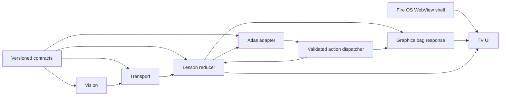

# Architecture and audit

## Repository audit

FireRoom initially contained AGENTS.md only; no Git repository or source tree existed. Read-only audit of adjacent `../AWS RallyRoom`: React/Vite/Three.js app with MediaPipe HandLandmarker, generation-aware camera cleanup, hand-to-paddle quaternion calibration, diagnostics, synthetic tests, and build artifacts. Its RESULTS.md explicitly leaves real camera validation pending. No physical results are inherited.

Reuse: installed dependency versions/toolchain, conceptual getUserMedia/model lifecycle cleanup and unmirrored inference/mirrored preview separation. No paddle quaternion, grip classification, calibration, or sport-specific scoring code copied: these estimate a virtual hand attachment and do not observe whole-body boxing. FireRoom uses PoseLandmarker shoulders/elbows/wrists and rule-based recovery cycles.

## Runtime decision and sources checked 2026-10-15

The official [Amazon hackathon announcement](https://community.amazondeveloper.com/t/build-ship-shape-amazon-developer-hackathon/29097) allows Fire OS or Vega OS and web technology. Amazon documents [Fire TV HTML5 apps](https://developer.amazon.com/docs/fire-tv/getting-started-with-web-apps.html) and [hybrid WebView development/testing](https://developer.amazon.com/docs/fire-tv/build-and-test-your-hybrid-app.html).

Selected implementation: Fire OS Android WebView shell around the hosted TV client, phone HTTPS browser for camera, trusted-network Node relay. This is architecture/documentary eligibility evidence; it is not runtime certification. Vega compatibility is not claimed. Selected Fire TV model, WebView version, remote navigation, GPU performance, and installed build must be verified on target. Android SDK exists locally; `adb devices` returned no connected devices. The available AVD is VECTR_API_35, not evidence of a Fire TV simulator.

## Boundaries and dependency graph

Shared contracts are owned by the lead. Specialist ownership follows AGENTS.md. Contract v1 defines producer-monotonic logical milliseconds, per-session increasing sequences, normalized unmirrored MediaPipe image coordinates, anatomical hands, explicit stance, visibility confidence, tracking status, error codes, and receiver-local arrival freshness. Only PoseFrame crosses the network and receives strict runtime validation; internal report/lesson/punch types are TypeScript contracts. GameAction carries schemaVersion 1 and is allowlist checked.

Camera frame sequence/timestamp state persists in sessionStorage, preserving the producer logical clock across Stop/Start and same-tab reloads. Reload requires the same tab storage; sharing a paired URL across producer tabs is unsupported. Clock offset is not synchronized between devices. Relay retains latest frame only and expires it after 750ms. No raw video is uploaded. Delayed in-flight network requests cannot be precisely age-calibrated; real latency requires measurement.

Vision requires visible shoulders/elbows/wrists; guard→extension→recovery emits a jab/cross mapped to stance. Confidence/tracking failures reset recognition. Extension is normalized joint geometry, not metric reach or force. Lesson reducer accepts ordered punches for three repetitions. Graphics receives virtual scores and runs preauthored demonstrations independent of player pose. The current visual guide is explicitly orthodox.

Atlas provides offline, report-grounded explanations and five bounded action types. Provider interface separates future Bedrock integration; provider-authored free text is not displayed without grounding. No live provider is configured or claimed. Credentials and a reviewed grounded response schema are needed before LLM validation.

## Dependency-aware execution plan

1. Phase 0 contracts/toolchain/audit → independent contract review. Software subgate PASS; full target gate awaits installed target build.
2. Phase 1 vision, graphics, and transport run independently against v1 contracts → unit tests → independent V&V → camera/TV component checks.
3. Phase 2 integrates pose→recognition→ordered lessons→report→bag/feedback. Synthetic and desktop smoke tests run now. Real camera walkthrough remains the critical path.
4. Validate controlled recognition (18/20 jabs; 18/20 crosses; ≤1/20 false punches), mirrored preview/anatomical hands, missing data recovery, trusted HTTPS, and phone/TV synchronization. Fix based on recorded data.
5. Phase 3 Bedrock credentials/provider grounding/timeouts/actions → independent provider tests. Offline fallback already available.
6. Only after Coach Mode target gate passes, implement optional short Arcade round. Submission follows physical/performance/reconnection/target tests.
